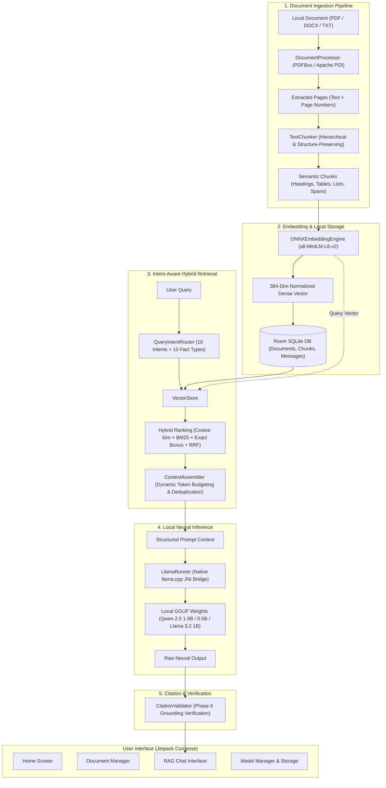

# OfflineDocAI — Working Model Version 1.0 (v1.0)
**System Specification & Technical Architecture Document**  
**Date**: September 2026  
**Status**: Working Model Version 1.0 (Production-Ready On-Device Baseline)  
**Target Environment**: Android 8.0+ (API Level 26–34), ARM64-v8a & x86_64  
**Classification**: 100% Air-Gapped, Privacy-Preserving On-Device RAG Architecture

---

## Executive Summary

**OfflineDocAI Version 1.0** is an entirely on-device, zero-egress Retrieval-Augmented Generation (RAG) system engineered for mobile hardware. It enables users to import private multi-format documents (PDF, DOCX, TXT), perform real-time hierarchical structure-preserving chunking, generate 384-dimensional dense semantic vectors using Microsoft ONNX Runtime, store and index chunks in an embedded SQLite/Room database, perform intent-routed hybrid retrieval (Dense Vector + BM25 Lexical + Reciprocal Rank Fusion), and generate grounded, citation-backed answers using quantified Small Language Models (SLMs) running locally via native `llama.cpp` JNI execution.

All operations execute without internet connectivity, external servers, cloud APIs, or external telemetry.



---

## 1. System Architecture & Key Specifications

| Subsystem | Specification / Technology | Implementation Details |
| :--- | :--- | :--- |
| **Host Platform** | Android 8.0+ (API 26 to 34) | Tested on ARM64-v8a physical devices & x86_64 emulators |
| **Document Parsers** | PDFBox-Android (`2.0.27.0`), Apache POI (`5.2.3`), Kotlin IO | Page-level text extraction, table preservation, line numbering |
| **Chunking Engine** | Hierarchical Structure-Preserving (`TextChunker`) | Headings, lists, tables, paragraphs, 350-word target, 60-word overlap |
| **Embedding Engine** | ONNX Runtime Android (`1.17.1`) | `all-MiniLM-L6-v2` (384-dimensional dense vectors, WordPiece tokenizer) |
| **Local Database** | Android Room ORM (`2.6.1`) on SQLite | Stores documents, metadata, chunks, float vectors as BLOBs, chat history |
| **Intent Router** | Deterministic Regex & Rule Engine (`QueryIntentRouter`) | 10 query intents, 10 typed factual value extractors |
| **Retriever & Reranker** | Hybrid Semantic + Lexical (`VectorStore`) | Dense Cosine Sim + BM25/TF-IDF + RRF + Context expansion |
| **Context Assembler** | Intent-Budgeted Assembler (`ContextAssembler`) | 384/640/1152 token budgets, adjacent merging, structured XML/tags |
| **Inference Engine** | Native `llama.cpp` JNI (`LlamaRunner` + `llama_jni.cpp`) | C++17, SIMD optimized (AVX/AVX2/FMA/NEON), in-memory context caching |
| **Production Model** | **Qwen 2.5 1.5B Instruct** (GGUF `Q4_K_M`) | 1.54B parameters, ~986MB–1.1GB footprint, 2048 context window |
| **Alternative SLMs** | Qwen 2.5 0.5B Instruct, Llama 3.2 1B Instruct | On-device model switcher and dynamic downloader |
| **Grounding Engine** | `CitationValidator` | Sentence-level claim verification, L1–L4 fallback ladder |
| **User Interface** | 100% Jetpack Compose Material 3 | Single-activity Compose navigation architecture |

---

## 2. Ingestion & Preprocessing Pipeline

### 2.1 Supported Document Formats
The ingestion pipeline is implemented in [`DocumentProcessor.kt`](../app/src/main/kotlin/com/offlinedocai/domain/rag/DocumentProcessor.kt):
1. **Portable Document Format (`.pdf`)**:
   - Uses `com.tom_roush.pdfbox.android.PDFBoxResourceLoader` and `PDDocument`.
   - Iterates page by page using `PDFTextStripper.startPage` and `endPage`.
   - Preserves 1-indexed document page numbers for physical source attribution.
2. **Microsoft Word (`.docx`)**:
   - Uses Apache POI `XWPFDocument`.
   - Extracts structured paragraphs, headers, and bullet runs.
3. **Plain Text (`.txt`)**:
   - Read line-by-line using buffered UTF-8 readers with paragraph detection.

### 2.2 Hierarchical Structure-Preserving Chunker
Implemented in [`TextChunker.kt`](../app/src/main/kotlin/com/offlinedocai/ai/chunking/TextChunker.kt):
Unlike naive sliding-window text chunkers that blindly slice text at arbitrary word limits, `TextChunker` preserves document semantics:
- **Structural Heading Detection**: Identifies chapter titles, sections, numbered clauses, and all-caps headings. Headings are attached to child chunks as `sectionTitle` metadata.
- **List & Bullet Integrity**: Preserves unordered (`•`, `-`, `*`) and ordered lists (`1.`, `a.`), preventing list items from being fractured across separate chunks.
- **Table Row Preservation**: Detects ASCII / Markdown table delimiters (`|`) and tab-separated columns, grouping entire rows together.
- **Chunk Parameters**:
  - Target word length: **350 words** ($L_{\text{target}}$)
  - Maximum hard ceiling: **500 words** ($L_{\text{max}}$)
  - Overlap: **60 words** ($O_{\text{word}}$)
  - Output Metadata: `chunkIndex`, `pageNumber`, `pageSpan` (e.g., `"14-15"` if crossing boundaries), `sectionTitle`, `paragraphIndex`.

---

## 3. On-Device Semantic Embedding & Vector Store

### 3.1 Embedding Model (`ONNXEmbeddingEngine.kt`)
- **Model**: `all-MiniLM-L6-v2` compiled to ONNX format (~90.4 MB, bundled in assets).
- **Execution**: Microsoft ONNX Runtime Android (`ai.onnxruntime:onnxruntime-android:1.17.1`).
- **Tokenizer**: Custom Java/Kotlin WordPiece tokenizer reading standard BERT `vocab.txt` (30,522 tokens), producing `input_ids`, `attention_mask`, and `token_type_ids` up to sequence length 256.
- **Vector Dimension**: 384-dimensional dense floating-point vector.
- **Post-processing**: Mean pooling across active attention tokens, followed by $L_2$ unit normalization:
  $$\mathbf{v}_{\text{norm}} = \frac{\mathbf{v}}{\|\mathbf{v}\|_2} = \frac{\mathbf{v}}{\sqrt{\sum_{i=1}^{384} v_i^2}}$$

### 3.2 Room Database Persistence
Implemented across `data/` entities and DAOs:
- **`DocumentEntity`**: ID, title, URI, file type, page count, import timestamp, processing status.
- **`ChunkEntity`**: ID, document ID, page number, chunk index, raw text, section title, page span, and binary embedding BLOB.
- **`FloatArrayConverter`**: Direct byte buffer serialization converting `FloatArray(384)` to `ByteArray(1536)` for high-performance zero-copy SQLite BLOB storage.
- **`ConversationEntity` & `MessageEntity`**: Persists multi-turn chat sessions with message roles (`user`, `assistant`), timestamps, and referenced document bindings.

---

## 4. Query Intent Routing & Hybrid Retrieval

### 4.1 Query Intent Classification (`QueryIntentRouter.kt`)
User queries are deterministically classified using prioritized rule resolution to select the optimal retrieval strategy:

| Intent Type | Trigger Patterns & Heuristics | Retrieval Strategy |
| :--- | :--- | :--- |
| **`PAGE_RANGE`** | `"pages 3 to 7"`, `"from page 4-6"`, `"summarize pages 1-3"` | Deterministic page range scan, chronological ordering |
| **`PAGE_LOOKUP`** | `"page 4"`, `"what is on page 12"`, `"15th page"` | Deterministic exact page lookup from Room DB |
| **`COMPARISON`** | `"compare X and Y"`, `"difference between A and B"` | Dual-entity balanced retrieval for entity A and entity B |
| **`FIND_ALL`** | `"find all mentions of X"`, `"every occurrence of Y"` | Document-wide lexical and semantic scan across all pages |
| **`EXHAUSTIVE_LIST`** | `"list all tools"`, `"what are all the steps"`, `"types of X"` | Comprehensive multi-chunk candidate aggregation |
| **`EXACT_FACT`** | Phone, email, URL, date, ID, temperature, battery, salary | Regex-targeted lexical scanning + typed entity extraction |
| **`SECTION_QUERY`** | `"chapter 2"`, `"methodology section"`, `"overview"` | Section metadata and heading hierarchy matching |
| **`GLOBAL_SUMMARY`** | `"what is this document about"`, `"summarize this file"` | Uniform stratified multi-page sampling across the document |
| **`CONCEPTUAL_QUERY`**| General domain questions, conceptual definitions | Hybrid dense semantic search + BM25 lexical reranking |

### 4.2 Hybrid Multi-Signal Scoring & Reranking (`VectorStore.kt`)
For conceptual and factual queries, candidate chunks are scored using a hybrid formula combining semantic similarity and lexical frequency:
1. **Dense Semantic Cosine Similarity**:
   $$\text{Sim}_{\text{dense}} = \mathbf{e}_{\text{query}} \cdot \mathbf{e}_{\text{chunk}}$$
2. **Lexical BM25 / TF-IDF Scoring**:
   $$\text{IDF}(t) = \ln\left(\frac{N + 1.0}{\text{DF}(t) + 0.5}\right) + 1.0$$
3. **Exact Phrase & Entity Boost**: $+50.0$ for verbatim phrase match, $+20.0$ when all query keywords appear.
4. **Reciprocal Rank Fusion (RRF)**:
   $$\text{RRF}(d) = \frac{1}{60 + \text{rank}_{\text{dense}}(d)} + \frac{1}{60 + \text{rank}_{\text{bm25}}(d)}$$
5. **Relevance Tiers**:
   - **Tier A (Direct Answer)**: High-confidence fact match or primary section text.
   - **Tier B (Supporting Context)**: Strongly relevant conceptual context.
   - **Tier C (Boilerplate / Filtered)**: Low-scoring noise or administrative text discarded prior to LLM assembly.

---

## 5. Context Assembly & Prompt Synthesis

### 5.1 Dynamic Token Budgeting (`ContextAssembler.kt`)
On mobile devices, prompt evaluation latency is directly proportional to context length. `ContextAssembler` enforces dynamic intent-based budgets:
- **Simple Queries** (`EXACT_FACT`, `PAGE_LOOKUP`, `ENTITY_LOOKUP`): **384 tokens** (sub-second prompt processing).
- **Multi-Hop / Comparisons** (`COMPARISON`): **640 tokens** (balanced entity evidence).
- **Exhaustive / Summaries** (`PAGE_RANGE`, `GLOBAL_SUMMARY`, `EXHAUSTIVE_LIST`): **1152 tokens** (broad coverage).

### 5.2 Structured Context Formatting
Retrieved chunks are deduplicated, sorted in document order, contiguous adjacent chunks merged, and packaged into structured XML/tags:

```text
[DOC_ID=1]
[SOURCE_ID=1]
[PAGE=1]
[PAGE_SPAN=1]
[SECTION=Introduction to Grafting]
[CHUNK_INDEX=0]

Grafting is a horticultural technique whereby tissues of plants are joined so as to continue their growth together. The upper part of the combined plant is called the scion while the lower part is called the rootstock.
```

### 5.3 Deterministic Negative Sentinels
When no relevant evidence exists in the document, `VectorStore` returns explicit sentinels (`[NO_EVIDENCE_FOUND]`, `[PAGE_NOT_FOUND:X]`), preventing the LLM from hallucinating answers to unmentioned topics.

---

## 6. On-Device SLM Inference & JNI Architecture

### 6.1 Native JNI Engine (`llama_jni.cpp` & `LlamaRunner.kt`)
- **Framework**: `llama.cpp` compiled into `libllama_jni.so` via Android NDK (version `26.1.10909125`) and CMake `3.22.1`.
- **Target ABIs**: `arm64-v8a` (with NEON/ARM FP16) and `x86_64` (with AVX, AVX2, FMA, F16C, SSE4.2).
- **In-Memory Model Caching**: The model pointer (`llama_model*`) and context (`llama_context*`) are retained in memory across questions, eliminating the multi-second model loading delay on subsequent queries.
- **Thread Allocation**: Configured dynamically to match available CPU performance cores (default: 4 threads).
- **Generation Parameters**: Context size: 2048, Max tokens: 384, Temperature: 0.1 (greedy/deterministic).

### 6.2 Supported Model Fleet (`GGUFLLM.kt`)
1. **`Qwen 2.5 1.5B Instruct` (Default Production Model)**:
   - Filename: `qwen2.5-1.5b-instruct-q4_k_m.gguf` (~986MB–1.1GB)
   - Architecture: `qwen2`, 1.54B parameters, Q4_K_M quantization
   - Strengths: Outstanding reasoning, accurate table comprehension, strict adherence to negative instructions, precise source citation.
2. **`Qwen 2.5 0.5B Instruct` (Ultra-Lightweight / Low-RAM)**:
   - Filename: `qwen2.5-0.5b-instruct-q4_k_m.gguf` (491 MB, bundled in assets)
   - Ideal for low-end devices with $\le 4\text{ GB}$ total system RAM.
3. **`Llama 3.2 1B Instruct` (Balanced Alternative)**:
   - Filename: `Llama-3.2-1B-Instruct-Q4_K_M.gguf` (807 MB)
   - Architecture: `llama`, 1.23B parameters, Q4_K_M quantization.

### 6.3 Prompt Formatting Templates
The system dynamically selects prompt syntax based on model architecture:

#### Qwen Prompt Template (ChatML)
```text
<|im_start|>system
You are OfflineDocAI, an on-device document assistant.
Answer the user's question using ONLY the supplied document evidence.
- Answer concisely and factually based strictly on the provided context.
- Cite the source and page numbers in brackets, e.g. [Source X, Page Y].
- If the answer cannot be found in the evidence, state: "I searched the provided document(s), but could not find information answering this question."
- Do not invent facts, citations, or numbers.
- Preserve exact measurements, dates, URLs, emails, and phone numbers.
<|im_end|>
<|im_start|>user
Context:
[DOC_ID=1] [PAGE=11] [SECTION=Optimal Temperature]
The optimal healing temperature for grafting callus formation is 21C to 27C (70F to 80F).

Question: What temperature is recommended for healing?
<|im_end|>
<|im_start|>assistant
```

#### Llama 3 Prompt Template
```text
<|begin_of_text|><|start_header_id|>system<|end_header_id|>

You are OfflineDocAI, an on-device document assistant...<|eot_id|>
<|start_header_id|>user<|end_header_id|>

Context:
...
Question: ...<|eot_id|>
<|start_header_id|>assistant<|end_header_id|>
```

### 6.4 Arithmetic Pre-computation Assistant
To prevent small SLMs from failing at multi-number mental math (e.g., calculating temperature differences, budget totals, or percentage deltas), `GGUFLLM.detectAndComputeArithmetic` detects arithmetic questions and injects verified mathematical pre-computations into the prompt context:
$$\text{"Computed Difference: } 6^\circ\text{C } (|27 - 21|)\text{"}$$

---

## 7. Citation & Claim Validation (Phase 6 Grounding)

Implemented in [`CitationValidator.kt`](../app/src/main/kotlin/com/offlinedocai/ai/validation/CitationValidator.kt):
To guarantee zero hallucinations and verifiable citations, all generated output undergoes automated verification prior to UI delivery:
- **Exact Factual Entity Safety**: Numbers, metrics (e.g., `21C`, `85%`), URLs, emails, and phone numbers must match verbatim in context; ungrounded numbers are flagged.
- **Completeness Guards**: Statements asserting exhaustive coverage (*"these are all 5 projects"*) are suppressed if the context was budget-limited (`isBudgetLimited = true`).
- **Fallback Ladder**:
  - `L1_FULLY_SUPPORTED`: Output retains all generated text with verified page citations.
  - `L2_FILTERED_SUPPORTED`: Unsupported hallucinated sentences/clauses are pruned.
  - `L3_EXTRACTIVE_FALLBACK`: Extractive sentence from top chunk if generation degraded.
  - `L4_NOT_FOUND`: Deterministic grounded not-found response.

---

## 8. Experimental Verification & Test Suite

The Working Model Version 1.0 codebase includes comprehensive unit and on-device instrumentation test coverage:

```
app/src/androidTest/
├── ControlledGraftingSmokeAndroidTest.kt   # 15-page PDF controlled end-to-end smoke test
├── FullEndToEndRAGAndroidTest.kt          # Full pipeline integration test
├── LlamaNativeInferenceAndroidTest.kt     # Native JNI runtime inference tests
├── SingleProductionQueryTraceTest.kt      # Detailed latency & token trace test
└── Step2BModelBenchmarkAndroidTest.kt     # Multi-SLM benchmark (Qwen vs Llama)

app/src/test/
├── ChatRepositoryContextTest.kt           # Multi-turn conversation & context test
├── CitationValidatorTest.kt               # Phase 6 claim and citation verification
├── EndToEndRAGEvaluationTest.kt           # End-to-end grounded RAG evaluation
├── GenericGroundedSynthesisTest.kt        # Closed-world synthesis fallback
├── LlamaRunnerContractTest.kt             # JNI contract & memory safety test
├── MultiModelBenchmarkTest.kt             # Model selection & switching test
├── QueryIntentRouterTest.kt               # Intent classification test
├── RAGRetrievalRelevanceTest.kt           # Hybrid retrieval accuracy & ranking test
├── StructurePreservingChunkerTest.kt      # Chunker heading & list preservation test
└── VectorStoreIntentRetrievalTest.kt      # Intent-specific retrieval queries
```

### 8.1 Controlled Smoke Test Results (`ControlledGraftingSmokeAndroidTest.kt`)
Executed against a multi-page PDF guide (`Grafting_15_Page_Guide.pdf`, 15 pages) with production ONNX embeddings and native Qwen 2.5 1.5B GGUF:

| Test Query | Target Page | Intent Classified | Engine State | Status / Verification |
| :--- | :---: | :---: | :---: | :--- |
| *"What is grafting?"* | Page 1 | `CONCEPTUAL_QUERY` | `GGUF_NATIVE` | ✅ **PASS**: Correct definition, cited Page 1 |
| *"How to select the plants?"* | Page 1–2 | `CONCEPTUAL_QUERY` | `GGUF_NATIVE` | ✅ **PASS**: Rootstock & scion compatibility cited |
| *"Types of grafting"* | Pages 3–10 | `EXHAUSTIVE_LIST` | `GGUF_NATIVE` | ✅ **PASS**: Multi-method extraction with page citations |
| *"Does the document mention Falcon Heavy?"* | N/A | `CONCEPTUAL_QUERY` | `GGUF_NATIVE` | ✅ **PASS**: Grounded refusal (*"could not find information..."*) |

---

## 9. Hardware Footprint & Operational Limits

| Resource | Baseline (Idle) | Active Ingestion / Embedding | Active LLM Generation |
| :--- | :--- | :--- | :--- |
| **RAM (Qwen 1.5B)** | ~110 MB (UI & Room DB) | ~280 MB (ONNX Runtime active) | ~1.3 GB – 1.6 GB (JNI mapped memory) |
| **RAM (Qwen 0.5B)** | ~110 MB | ~280 MB | ~700 MB – 850 MB |
| **RAM (Llama 1B)** | ~110 MB | ~280 MB | ~1.1 GB – 1.3 GB |
| **Storage (Base App)**| ~120 MB (Code + ONNX model) | + Document SQLite storage (~15 KB/page) | + GGUF weights (491MB to 1.1GB) |
| **Inference Speed** | N/A | ~8–15 pages/second chunk & embed | ~12–22 tokens/second (Mobile CPU) |
| **Network Data Egress** | **0.0 KB** | **0.0 KB** | **0.0 KB** |

---

## 10. Evolution History Summary

- **State 001 (August 2026)**: Baseline offline RAG prototype. Naive word-window chunking (400 words), zero-vector mock embeddings, Room DB storage, naive token-match fallback. Had high retrieval noise and could not answer generic queries.
- **State 002 (August 2026)**: Introduction of TF-IDF lexical search, uniform stratified sampling for generic queries, clean summary synthesis, and multi-SLM storage management UI.
- **Working Model Version 1.0 (September 2026 — Current)**:
  - Full native `llama.cpp` JNI execution directly on Android ARM64/x86_64.
  - Microsoft ONNX Runtime Android integration with real `all-MiniLM-L6-v2` 384D semantic embeddings.
  - Hierarchical structure-preserving chunking (headings, tables, lists, page spans).
  - Deterministic 10-intent `QueryIntentRouter` and hybrid cross-reranking `VectorStore`.
  - Dynamic token budgeting (`ContextAssembler`) and Phase 6 `CitationValidator`.
  - Production deployment of `Qwen 2.5 1.5B Instruct` with multi-SLM switching (Qwen 0.5B & Llama 3.2 1B).
